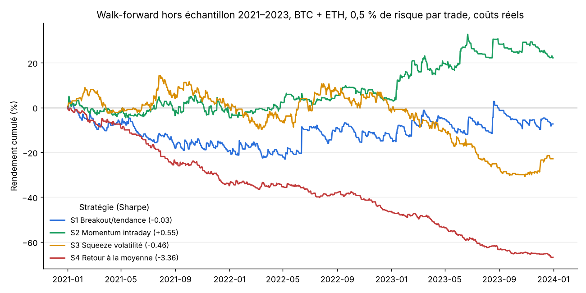
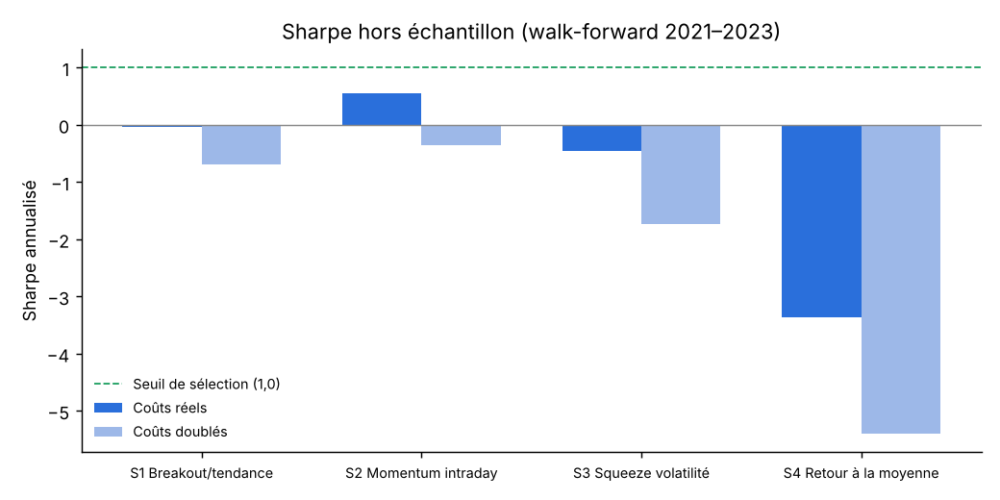

# Tâche 2 — Premiers backtests (vague 1) — 2026-11-18

**Conclusion : aucune des 4 stratégies ne passe les critères de sélection. S3 et S4 sont abandonnées.
S1 et S2 montrent un petit avantage réel avant frais, mais les frais en mangent la moitié ou plus.**
Tous les chiffres ci-dessous viennent des scripts du dépôt (`research/experiments/t2_first_wave*.py`),
résultats bruts dans `reports/t2_first_wave/`.

## Cadre

- Données : perpétuels OKX BTC-USDT-SWAP et ETH-USDT-SWAP, bougies 1 min, **2020-01-01 → 2023-12-31 uniquement**
  (période de développement ; 2024+ non chargé).
- Exécution : signal à la clôture, entrée à l'ouverture suivante ; stops/TP vérifiés minute par minute,
  pire cas si les deux dans la même minute ; frais taker 0,05 %/côté ; slippage 1 pb (marché) et 3 pb (stops) ;
  funding 0,01 %/8 h toujours payé ; 0,5 % de risque par trade ; position plafonnée à 1x le capital (sans levier).
- Walk-forward : 12 mois d'apprentissage → 3 mois de test, 12 fenêtres, tests de **janv. 2021 à déc. 2023**.
  Choix de la config sur le Sharpe d'apprentissage (au moins 10 trades).
- Essais : 65 configurations × 2 actifs = 130 backtests, tous journalisés (`trial_log.csv`).
- 19 tests automatiques passent (règles d'exécution, absence de look-ahead des 4 stratégies, index en ms).
- Bug trouvé et corrigé en cours de route : décalage d'unité de temps (ms/ns) qui faisait durer les trades
  indéfiniment. Les résultats ci-dessous sont postérieurs à la correction ; un test de régression a été ajouté.

## Résultats hors échantillon (walk-forward 2021–2023, BTC + ETH)

| Stratégie | Trades | Trades/mois | Rendement | CAGR | Sharpe | Sortino | DD max | Réussite | PF | Gain/perte moyens (% capital) | Durée moy. | Exposition | Sharpe coûts x2 |
|---|---|---|---|---|---|---|---|---|---|---|---|---|---|
| S1 Breakout/tendance 1 h | 717 | 19,9 | -7,3 % | -2,5 % | -0,03 | -0,10 | -25,6 % | 26,6 % | 0,99 | +1,35 / -0,49 | 20,9 h | 28,5 % | -0,70 |
| S2 Momentum intraday 1 h | 1 115 | 31,0 | +22,2 % | +6,9 % | 0,55 | 0,89 | -9,5 % | 41,4 % | 1,10 | +0,57 / -0,37 | 11,3 h | 24,0 % | -0,35 |
| S3 Squeeze volatilité 1 h | 1 023 | 28,4 | -22,9 % | -8,3 % | -0,46 | -0,82 | -39,4 % | 35,1 % | 0,94 | +0,94 / -0,54 | 13,2 h | 25,7 % | -1,73 |
| S4 Retour à la moyenne 15 min | 968 | 26,9 | -66,8 % | -30,8 % | -3,36 | -3,80 | -67,0 % | 43,4 % | 0,60 | +0,38 / -0,49 | 1,9 h | 3,5 % | -5,40 |

Référence achat-conservation sur la même période : BTC +44 % (DD -77 %, Sharpe 0,51), ETH +213 % (DD -79 %, Sharpe 0,87).

## Contre les critères de sélection (D-003)

| Critère | Seuil | S1 | S2 | S3 | S4 |
|---|---|---|---|---|---|
| Sharpe OOS | ≥ 1,0 | -0,03 ✗ | 0,55 ✗ | -0,46 ✗ | -3,36 ✗ |
| Deflated Sharpe | ≥ 95 % | 13 % ✗ | 8 % ✗ | 10 % ✗ | 0 % ✗ |
| Profit factor | ≥ 1,3 | 0,99 ✗ | 1,10 ✗ | 0,94 ✗ | 0,60 ✗ |
| DD max | ≤ 15 % | 25,6 % ✗ | 9,5 % ✓ | 39,4 % ✗ | 67 % ✗ |
| Trades OOS | ≥ 150 | ✓ | ✓ | ✓ | ✓ |
| Rentable coûts x2 | oui | ✗ | ✗ | ✗ | ✗ |

Deflated Sharpe calculé avec les essais de la même famille (version la plus favorable) ; avec les 65 essais
toutes familles confondues, il vaut 0 % pour les quatre.

## Ce que disent les chiffres

1. **Les frais sont le problème central.** Rendement moyen par trade, en multiples du risque (R), avant → après coûts :
   S1 +0,16 R → +0,08 R ; S2 +0,07 R → +0,02 R ; S3 +0,09 R → -0,01 R ; S4 -0,10 R → -0,29 R.
   Un aller-retour coûte ~0,12 % alors que les stops moyens sont à 2–2,7 % : la marge brute est trop fine.
2. **S1 a profité de 2020.** Sur 2020–2023, ses 18 configurations sont toutes positives (Sharpe médian 0,61, max 1,27,
   PBO 0,03). Sur 2021–2023 seulement, le médian tombe à -0,08 et 39 % des configs sont positives :
   l'avantage venait surtout de la tendance exceptionnelle de 2020.
3. **S2 est la plus régulière** (DD -9,5 %, 57 % de mois positifs, positive sur BTC et ETH), mais elle ne tient
   pas avec des coûts doublés et son Sharpe hors échantillon (0,55) est loin du seuil.
4. **Il y a bien un signal, faible.** Les meilleures configs S1, S2, S3 battent nettement des entrées au hasard
   avec les mêmes sorties (Sharpe des entrées aléatoires : médiane -0,3 à -1,5). Mais c'est la meilleure config
   sur 2020–2023, donc optimiste.
5. **S4 perd même avant frais** (-0,10 R brut) : le retour à la moyenne en 15 min ne fonctionne pas sur BTC/ETH
   dans ce cadre. Elle fait pire que des entrées aléatoires.
6. **Le walk-forward change souvent de config** (S1 : 5 configs différentes en 12 fenêtres) : instabilité des
   paramètres, mauvais signe pour la robustesse.

Lectures par régime (à prendre avec prudence, elles ont été observées a posteriori) : S1 et S2 font mieux en
faible volatilité et en marché latéral sur 30 jours qu'en forte volatilité.

## Décisions proposées

- **Abandon de S3 et S4** (règle 9 : on abandonne plutôt qu'on ne torture les paramètres).
- **S1 et S2 restent candidates pour une vague 2**, avec des changements décidés à l'avance, pas tirés des résultats
  par régime : moins de trades et plus de marge brute par trade.

## Pistes pour la vague 2 (à valider)

1. Horizon plus long : signaux 4 h et durées de 1 à 3 jours (la littérature trouve les tendances longues plus robustes).
2. Entrées en ordre limite (frais maker 0,02 %), avec une simulation prudente des ordres non remplis.
3. Combinaison S1 + S2 et extension à SOL, XRP, DOGE (plus de trades indépendants).
4. Filtre de sélectivité commun (score), testé en walk-forward.

Chaque nouvelle variante compte comme un essai supplémentaire dans le Deflated Sharpe.
