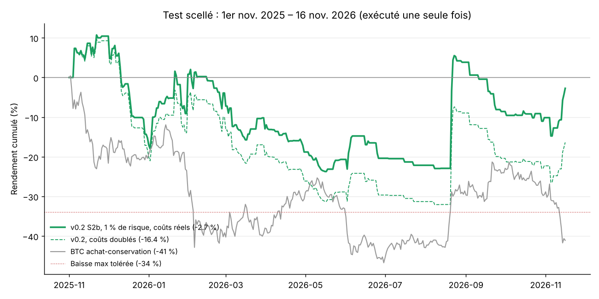

# Tâche 2 — Test scellé de la v0.2 (2026-11-18) : ÉCHEC

**La v0.2 (S2b seule, 1 % de risque par trade, levier de compte max 3x) finit à -2,7 % sur le test scellé
(1er nov. 2025 → 16 nov. 2026), Sharpe 0,11, profit factor 1,00, baisse max -31 %. Verdict pré-enregistré : ÉCHEC.
Pas de déploiement.** Avec des coûts doublés : -16,4 %, baisse max -38 %.

Script : `research/experiments/t2_sealed_test.py`, exécuté une seule fois après le commit de D-008.
Résultats : `reports/t2_sealed_test/`.

## Contexte de marché

Année très baissière : BTC -41 %, ETH -53 %, SOL -62 %, XRP -62 %, DOGE -69 % (baisses max de -47 % à -69 %).

## Détails

| Mesure | Valeur |
|---|---|
| Trades | 430 (aucun ignoré par le plafond) |
| Rendement | -2,7 % |
| Sharpe / Sortino | 0,11 / 0,17 |
| Baisse max | -31,1 % |
| Profit factor | 1,00 |
| Réussite | 41,9 % |
| Durée moyenne | 30 h |
| Exposition notionnelle max | 2,3x (moyenne 0,72x quand des positions sont ouvertes) |
| Positions longues | 43 % des trades, -9,7 % de PnL ; positions courtes : +9,8 % |
| PnL par actif | ETH +15,0 %, XRP +3,7 %, BTC +1,9 %, DOGE -9,4 %, SOL -11,1 % |

Mois : nov. +10,4 ; déc. -23,3 ; janv. +19,0 ; févr. -4,7 ; mars -9,4 ; avr. -6,7 ; mai -2,3 ; juin +0,4 ;
juil. -2,2 ; août +33,4 ; sept. -12,0 ; oct. -1,7 ; nov. (au 16) +8,2 (en %).

## Lecture

1. **L'avantage mesuré en 2021–2025 n'a pas tenu** sur la dernière année. Les gains arrivent en quelques mois
   explosifs (janvier, août) séparés de longues érosions : le profil est trop irrégulier.
2. **Point positif relatif** : la stratégie a quasiment préservé le capital dans une année où les cryptos ont perdu
   41 à 69 %, grâce aux positions courtes. Ce n'est pas suffisant pour nos critères.
3. **Le levier n'est pas la solution** : à 1 % de risque, la baisse max atteint déjà -31 %. Plus de levier aurait
   amplifié les pertes sans créer d'avantage.

## Conséquences

- Toutes les données historiques ont maintenant servi (développement, validation, test scellé). Il n'existe plus
  de juge historique neutre : **la prochaine preuve devra venir du trading simulé en temps réel (paper trading)**.
- Nombre total d'essais : 525 configurations + 2 validations pré-enregistrées.
