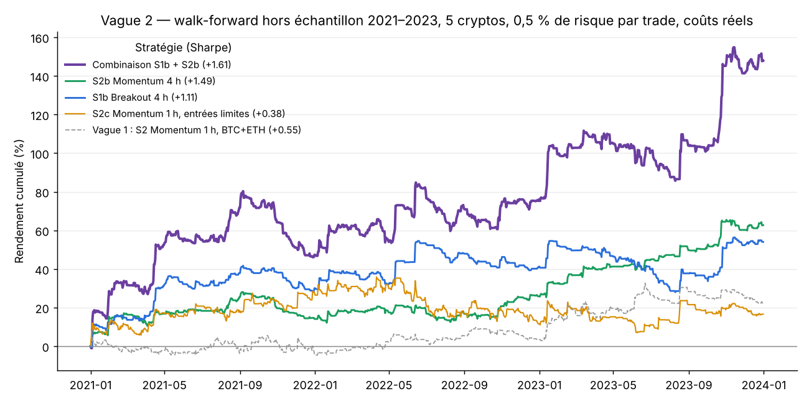

# Tâche 2 — Vague 2 de backtests (2026-11-18)

**Conclusion : passer à un horizon 4 h change tout. S2b (momentum 4 h) est la meilleure candidate :
Sharpe hors échantillon 1,49, drawdown max 12,5 %, rentable avec des coûts doublés (Sharpe 1,10).
Mais elle ne passe pas encore le Deflated Sharpe calculé sur les 525 essais cumulés (54 % au lieu de 95 %).**
Seule la période de validation (2024 → oct. 2025), jamais utilisée, pourra trancher.

Scripts : `research/experiments/t2_second_wave.py`, résultats bruts : `reports/t2_second_wave/`.

## Ce qui a changé par rapport à la vague 1 (décidé avant les résultats)

1. Signaux 4 h, durées de 12 h à 3 jours ; filtre de tendance journalier pour S1b.
2. Entrées possibles en ordre limite, 0,1 ATR plus favorable que la clôture, valables une seule bougie,
   remplies seulement si le prix passe strictement au-delà ; frais maker 0,02 % à l'entrée, sorties taker.
3. 5 actifs : BTC, ETH (bougies 1 min), SOL, XRP, DOGE (bougies 5 min) ; une seule config par stratégie pour tous les actifs.
4. S2c : le momentum 1 h de la vague 1 en entrées limites, pour isoler l'effet des frais.

Cadre inchangé : période 2020–2023 uniquement, walk-forward 12 mois / 3 mois (tests 2021–2023), 0,5 % de risque
par trade, sans levier par position, funding 0,01 %/8 h toujours payé, 24 tests automatiques passent
(dont 2 nouveaux sur les ordres limites et 3 sur l'absence de look-ahead).

## Résultats hors échantillon (walk-forward 2021–2023, 5 cryptos)

| Stratégie | Trades | /mois | Rendement | CAGR | Sharpe | Sortino | DD max | Réussite | PF | Durée moy. | Trimestres + | Sharpe coûts x2 |
|---|---|---|---|---|---|---|---|---|---|---|---|---|
| S1b Breakout 4 h | 650 | 18,1 | +54,1 % | +15,5 % | 1,11 | 2,11 | -17,2 % | 40,8 % | 1,34 | 55 h | 7/12 | 0,88 |
| **S2b Momentum 4 h** | 1 339 | 37,2 | +62,8 % | +17,6 % | **1,49** | 2,37 | **-12,5 %** | 48,5 % | 1,31 | 16 h | 10/12 | **1,10** |
| S2c Momentum 1 h limites | 1 749 | 48,6 | +16,6 % | +5,2 % | 0,38 | 0,64 | -21,2 % | 41,5 % | 1,06 | 10 h | 7/12 | -0,21 |
| Combinaison S1b + S2b | 1 989 | 55,2 | +147,9 % | +35,3 % | 1,61 | 3,23 | -19,0 % | 46,0 % | 1,32 | 29 h | 9/12 | — |

Le rendement de la combinaison est plus élevé surtout parce qu'elle prend deux fois plus de positions
(risque total plus élevé) ; son Sharpe est la mesure comparable.

## Contre les critères de sélection

| Critère | Seuil | S1b | S2b | Combinaison |
|---|---|---|---|---|
| Sharpe OOS | ≥ 1,0 | 1,11 ✓ | 1,49 ✓ | 1,61 ✓ |
| Deflated Sharpe (525 essais cumulés) | ≥ 95 % | 26 % ✗ | 54 % ✗ | 65 % ✗ |
| Deflated Sharpe (famille seule) | info | 96 % | 91 % | — |
| PBO | ≤ 0,30 | 0,34 ✗ | 0,09 ✓ | — |
| Profit factor | ≥ 1,3 | 1,34 ✓ | 1,31 ✓ | 1,32 ✓ |
| DD max | ≤ 15 % | 17,2 % ✗ | 12,5 % ✓ | 19,0 % ✗ |
| Trades OOS | ≥ 150 | ✓ | ✓ | ✓ |
| Fenêtres positives | ≥ 60 % | 58 % ✗ | 83 % ✓ | 75 % ✓ |
| Rentable coûts x2 | oui | ✓ | ✓ | ✓ |
| Aucun actif > 50 % du profit | oui | DOGE 55 % ✗ | DOGE 35 % ✓ | — |
| Aucune année > 50 % du profit | oui | 2021 : 58 % ✗ | 2023 : 52 % ✗ (limite) | — |
| Toutes les configs positives 2021–2023 | info | 100 % | 100 % | — |

## Enseignements

1. **L'horizon est le levier principal**, pas les frais maker : le momentum 1 h en entrées limites (S2c) reste faible
   (Sharpe 0,38). Pour S2b, les paramètres lents gagnent : rétrospective 12 bougies (48 h) → Sharpe médian 1,41
   contre 0,65 pour 3 bougies. C'est cohérent avec la littérature (tendances longues plus robustes).
2. **Les entrées limites aident S2b** (Sharpe médian de la grille 1,05 contre 0,77 au marché) mais pas S1b (1,07 contre 1,11).
3. **Robustesse encourageante** : 100 % des configurations de S1b et S2b sont positives sur 2021–2023 ;
   PBO de S2b à 0,09.
4. **Les altcoins portent une grande part du profit** (DOGE et SOL), surtout pour S1b : fragile.

## Risques et limites à traiter

- **Liquidité des X-Perps** : les X-Perps BTC montrent des minutes à volume nul (relevé du 18/11). Les tests utilisent
  les prix des perpétuels globaux, beaucoup plus liquides. Slippage et taux de remplissage des ordres limites
  devront être mesurés sur les X-Perps avant toute conclusion.
- **Exposition cumulée** : la combinaison dépasse 1x le capital en notionnel 2,5 % du temps (max 1,92x) et le risque
  ouvert simultané monte jusqu'à 6 %. Il faudra un plafond au niveau du portefeuille (Tâche 4).
- **Funding** : modélisé à 0,01 %/8 h, toujours payé. Le vrai historique (Binance) reste à intégrer.
- Les bougies 5 min des altcoins rendent la vérification des stops moins fine que pour BTC/ETH (règle du pire cas conservée).

## Proposition

Figer une version candidate (S2b seule, ou S2b + S1b avec plafond d'exposition et sans DOGE dominant), puis
la passer **une seule fois** sur la période de validation 2024 → oct. 2025, sans réoptimisation.
