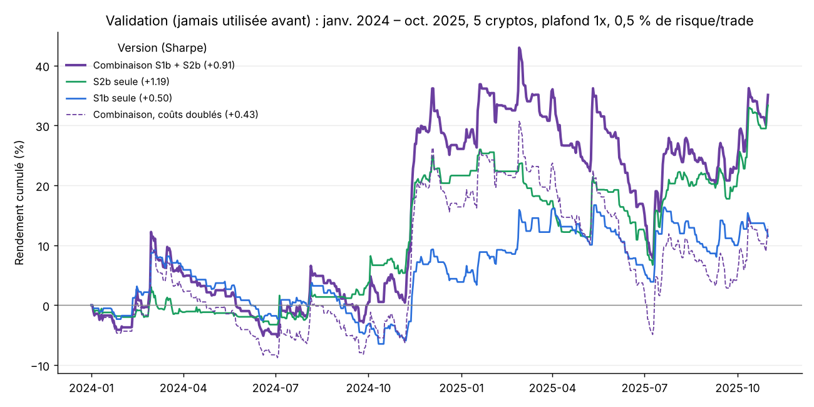

# Tâche 2 — Validation de la version candidate v0.1 (2026-11-18)

**Résultat : la combinaison S1b + S2b reste gagnante sur la période de validation, jamais utilisée avant
(+35 % de janvier 2024 à octobre 2025, Sharpe 0,91), mais elle ÉCHOUE aux critères pré-enregistrés :
drawdown -24,6 % (seuil 15 %), profit factor 1,15 (seuil 1,3), Sharpe sous 1.**
Conformément à D-007, aucun paramètre n'a été ajusté après coup.

Script : `research/experiments/t2_validation.py` (exécuté une seule fois). Résultats : `reports/t2_validation/`.
Procédure identique à la vague 2 + plafond d'exposition 1x, figée dans `docs/decisions/D-007_candidate_v0.1_preregistration.md`
avant le calcul. Données chargées jusqu'au 31/10/2025 inclus (le test final reste scellé).

## Chiffres

| | Développement 2021–2023 (walk-forward, plafond 1x) | **Validation 2024 – oct. 2025** | Validation, coûts x2 |
|---|---|---|---|
| Trades | 1 966 | 1 040 | 1 040 |
| Rendement | +145 % | **+35,1 %** | +13,1 % |
| CAGR | +34,8 % | +17,8 % | +6,9 % |
| Sharpe | 1,62 | **0,91** | 0,43 |
| Sortino | 3,24 | 1,66 | 0,76 |
| DD max | -18,9 % | **-24,6 %** | -27,2 % |
| Réussite | 46,2 % | 41,5 % | 40,4 % |
| Profit factor | 1,32 | **1,15** | 1,06 |
| Trimestres positifs | 8/12 | 6/8 | 6/8 |
| Durée moyenne | 29 h | 37 h | 37 h |

Trimestres de la validation : 2024T1 +5,4 % ; T2 -9,7 % ; T3 +5,1 % ; T4 +26,0 % ; 2025T1 +7,6 % ; T2 -14,3 % ; T3 +5,6 % ; oct. +10,0 %.

Par stratégie (sans plafond commun) : **S2b Sharpe 1,19, +33,3 %, DD -15,3 %** ; S1b Sharpe 0,50, +11,5 %, DD -14,3 %.

Répartition du profit : ETH 56 %, DOGE 44 %, XRP 18 %, SOL 3 %, **BTC -20 %** ; S2b 76 %, S1b 24 % ; 2024 77 %, 2025 23 %.
Le plafond 1x a ignoré 50 trades et en a réduit 36.

Référence achat-conservation sur la même période : BTC +159 % (DD -28 %), ETH +68 % (DD -64 %), XRP +307 %,
SOL +83 %, DOGE +108 % (DD -60 à -70 %).

## Contre les critères (D-003)

| Critère | Seuil | Validation | |
|---|---|---|---|
| Sharpe | ≥ 1,0 | 0,91 | ✗ |
| Profit factor | ≥ 1,3 | 1,15 | ✗ |
| DD max | ≤ 15 % | 24,6 % | ✗ |
| Rentable coûts x2 | oui | +13 % (Sharpe 0,43) | ✓ |
| Trimestres positifs | ≥ 60 % | 75 % | ✓ |
| Trades | ≥ 150 | 1 040 | ✓ |
| Aucun actif > 50 % du profit | oui | ETH 56 % | ✗ |
| Aucune année > 50 % du profit | oui | 2024 : 77 % | ✗ |
| Deflated Sharpe (525 essais) | ≥ 95 % | ≈ 0 % | ✗ |

Note sur le Deflated Sharpe : la barre de chance est gonflée par la grande dispersion des essais (les stratégies
très perdantes de la vague 1 l'élargissent). Le critère reste néanmoins clairement non atteint.

## Lecture

1. **Dégradation attendue mais forte** : le Sharpe passe de 1,62 à 0,91. L'avantage existe toujours (positif,
   y compris avec coûts doublés), mais il est plus faible que ce que suggérait le développement.
2. **S2b tient mieux que S1b** (1,19 contre 0,50). S1b, déjà fragile en développement (dépendance à DOGE), s'essouffle.
3. **Le risque est trop élevé pour le profil « modéré »** : deux baisses de 10 à 15 % sur un trimestre (2024T2, 2025T2).
4. **BTC perd de l'argent** sur la validation alors que c'est l'actif le plus liquide des X-Perps.

## Conséquences

- La validation 2024–2025 a maintenant servi : toute nouvelle version choisie en regardant ces résultats
  (par exemple « S2b seule ») ne pourra plus être jugée de façon neutre que sur le **test scellé**
  (nov. 2025 → nov. 2026), qu'on ne peut utiliser qu'une fois.
- La version v0.1 n'est pas déployable en l'état selon nos propres règles.
