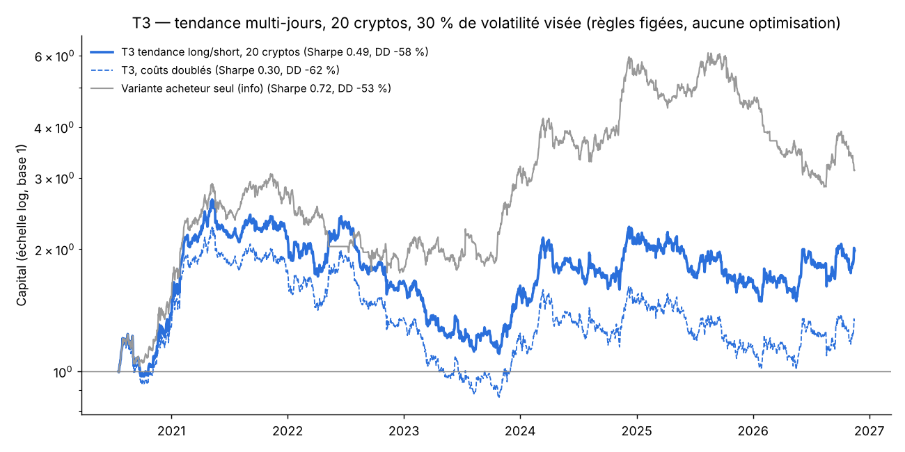

# T3 — Tendance multi-jours long/short sur 20 cryptos (2026-11-18) : ÉCHEC

**Règles figées avant calcul (D-009), aucune optimisation. Sur juillet 2020 → novembre 2026 : CAGR +11,4 %,
Sharpe 0,49, baisse maximale -58 %, 3 années positives sur 6. Critères non atteints.**
Seul point conforme : les 12 derniers mois sont positifs (+20 %) alors que 19 des 20 cryptos ont perdu de 17 à 78 %.

Script : `research/experiments/t3_trend.py`. Résultats : `reports/t3_u20/` (et `reports/t3_u5/`, calcul préliminaire sur 5 actifs, même conclusion).

| Version | CAGR | Sharpe | DD max | 12 derniers mois | Levier moyen | Frais / an | Funding / an |
|---|---|---|---|---|---|---|---|
| **T3 (règles D-009)** | +11,4 % | 0,49 | -58,3 % | +20,0 % | 0,76x | 2,2 % | 3,6 % |
| T3 coûts x2 | +4,6 % | 0,30 | -61,9 % | +16,6 % | 0,76x | 4,4 % | 7,3 % |
| Info : acheteur seul | +19,7 % | 0,72 | -53,2 % | -34,8 % | 0,44x | 1,0 % | 4,4 % |
| Info : volatilité visée 20 % | +8,8 % | 0,49 | -45,2 % | +16,5 % | 0,51x | 1,4 % | 2,6 % |
| Info : volatilité visée 40 % | +13,9 % | 0,52 | -71,6 % | +34,7 % | 0,99x | 3,0 % | 4,9 % |

Par année (T3) : 2020 +37,6 % (à partir de juillet) ; 2021 +55,9 % ; 2022 -22,1 % ; 2023 -5,6 % ; 2024 +30,5 % ;
2025 -18,4 % ; 2026 (au 16/11) +18,0 %.

| Critère (D-009) | Seuil | Résultat |
|---|---|---|
| Sharpe toute période | ≥ 0,8 | 0,49 ✗ |
| Sharpe coûts x2 | ≥ 0,5 | 0,30 ✗ |
| Années positives 2020–2025 | ≥ 4/6 | 3/6 ✗ |
| 12 derniers mois | > 0 | +20,0 % ✓ |
| Baisse max | ≤ 35 % | -58,3 % ✗ |

## Lecture

- Les positions longues font plus que tout le profit (137 %) ; **les positions courtes perdent de l'argent** sur la
  période complète, sauf dans la dernière année. Les marchés baissiers crypto sont faits de rebonds violents qui
  piègent les vendeurs.
- Le funding coûte 3,6 % par an : les positions longues paient la plupart du temps.
- Le levier ne change pas le Sharpe (0,49 à 0,52 entre 20 % et 40 % de volatilité visée) : il agrandit seulement les baisses.

## Bilan des trois familles testées

| Famille | Meilleur résultat hors réglage | Verdict |
|---|---|---|
| Intraday 15 min–1 h (S1–S4) | Sharpe 0,55 | Écarté |
| Momentum / cassures 4 h (S1b, S2b) | Validation 0,91 ; test scellé 0,11 | Écarté |
| Tendance multi-jours 20 cryptos (T3) | Sharpe 0,49, DD -58 % | Écarté |

Aucune stratégie directionnelle testée n'a un avantage robuste une fois les coûts réels déduits.
